# GeoCamPal

<p align="center">
  
  
  <a href="https://doi.org/10.5281/zenodo.23082278"></a>
</p>

<p align="center">
  <strong>A modular GUI-driven toolbox for geospatial image processing, camera pre-processing, georeferencing, feature labelling, semi-automatic feature detection, machine-learning integration, DEM generation, timestacking, and wave run-up analysis.</strong>
</p>


---

## Overview

**GeoCamPal** is a modular, GUI-driven Python toolbox for geospatial image-processing workflows. It brings together camera pre-processing, lens correction, image quality filtering and harmonisation, ground-control-point (GCP) digitising, georeferencing, feature identification and labelling, exploratory image analysis, DEM generation, timestack generation, and wave run-up analysis in a single application.

The software is designed for practical fixed-camera and coastal image-analysis workflows, while remaining useful for broader time-lapse, geospatial image processing, and image classification tasks.

<p align="center">
  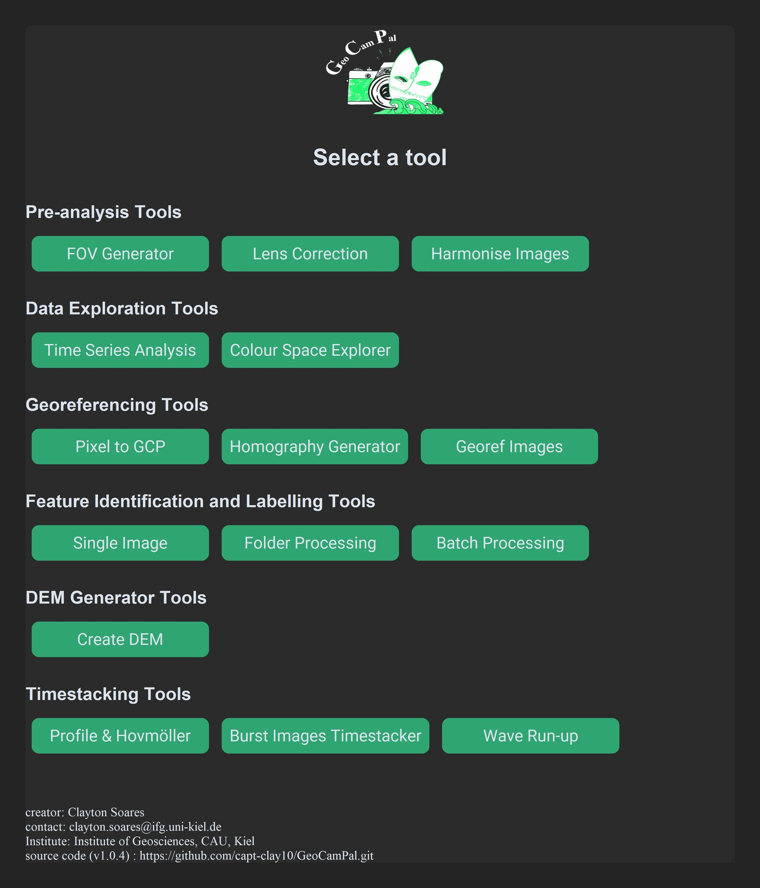
</p>

<p align="center">
  <em>GeoCamPal launcher (v1.0.4).</em>
</p>

---

## Table of Contents

- [Overview](#overview)
- [What's new in v1.0.4](#whats-new-in-v104)
- [Main Capabilities](#main-capabilities)
- [Installation](#installation)
- [Examples and tutorials](#examples-and-tutorials)
- [Modules](#modules)
  - [Launcher](#launcher)
  - [Pre-analysis Tools](#pre-analysis-tools)
  - [Data Exploration Tools](#data-exploration-tools)
  - [Georeferencing Tools](#georeferencing-tools)
  - [Feature Identification and Labelling Tools](#feature-identification-and-labelling-tools)
  - [DEM Generator Tools](#dem-generator-tools)
  - [Timestacking Tools](#timestacking-tools)
- [Typical Outputs](#typical-outputs)
- [Dependencies](#dependencies)
- [Citation](#citation)
- [Contributing](#contributing)
- [License](#license)
- [Disclaimer](#disclaimer)
- [Creator and Contact](#creator-and-contact)

---

## What's new in v1.0.4

**New functions**

- **Harmonise Images:** the quality filter can be limited to an area of interest (**Filter inside AOI only**, **Select AOI**), for example to leave out a bright sky or the sun; an interrupted filter run can be **continued**; every finished run writes a **`filter_summary.txt`** with the counts per rejection reason.
- **Homography Generator:** **Compute Accuracy** reports, for each GCP, the distance for the matrix fitted on all GCPs and the **leave-one-out** distance, with mean, median, RMS and maximum, and saves them as `<name>_accuracy.csv`.
- **Pixel to GCP:** GCP files with **projected Easting/Northing** coordinates are accepted, with the EPSG code from the file or a new field (0 for a local system).
- **Lens Correction:** the report opens with a **Result** block, giving the lens distortion as the largest pixel shift with a **±** (from repeating the calibration without each photo in turn) and the checkerboard fit, and ends with an **Interpretation** section.
- **Feature Identification and Labelling Tools:** each shape can carry its **own label and category ID**; images with several labels are also exported as a **multi-class dataset** (label-map PNG, GeoJSON with label attributes, COCO with all categories, `categories.json`). The shape editor has Delete Shape, Cancel, shape selection and full undo/redo.
- **Wave Run-up:** the Stockdon comparison states whether the observed R₂% is **vertical or horizontal** and reports the **observed significant swash height S** (4 × the standard deviation of the detrended swash).
- **Georef Images:** zoomable preview panels, and a progress bar, the remaining time and **Stop optimisation** for the GCP optimisation.
- **All tools:** windows and plots fit the screen at any display scaling; the launcher uses consistent tool names; all 13 examples were regenerated with v1.0.4.

**Fixes that change results** (recompute affected outputs made with earlier versions)

- **Wave Run-up:** with a PNG mask and **Land on left**, distance was counted from the wrong side, so the observed R₂% was taken on the backwash side.
- **Create DEM:** DEM GeoTIFFs lay half a cell to the south-east; their origin is now half a cell further north-west (heights unchanged).
- **Georef Images:** Homography and Camera Projection GeoTIFFs lay half an output pixel to the south-east; with an AOI, Thin Plate Spline and Polynomial outputs were shifted by the AOI offset. Thin Plate Spline and Polynomial now read GCP pixel coordinates as pixel centres, so their pixel values change slightly.
- **Feature Identification and Labelling Tools:** detected vertices are now placed at pixel centres. They lay to the north-west by half a pixel of the reduced working copy plus half an image pixel: for an image of 4700 px with 0.25 m pixels, 0.6 m in Batch Processing and 1.1 m in Single Image. Single Image, Folder and Batch Processing now use the same 1200 px working copy, so masks and shape counts in Single Image and Folder Processing change.
- **Feature Identification and Labelling Tools:** with **Create Line** and **Continue Line**, each new point was added at the nearer end of the line, so a line that turns back towards its start (such as a run-up line on a timestack) was stored and exported with its points in the wrong order (v1.0.1 to v1.0.3).
- **Pixel to GCP:** with the image zoomed in, a click could be stored as the neighbouring pixel; with the image zoomed out, the first of the image pixels under the cursor was stored instead of the middle one.
- **FOV Generator:** the ground height under the camera was read from the wrong DEM cell, and the viewshed terrain lay half a DEM cell to the north-west.
- **Wave Run-up:** with GeoJSON or COCO annotations and **Land on left**, distance is now counted from the image edge instead of the annotation's own most seaward point; the distance columns shift by a constant, while the detrended columns, the spectrum and the observed R₂% do not change.

The full list of changes is in the [release notes](https://github.com/capt-clay10/GeoCamPal/releases).

---

## Main Capabilities

| Tools | Modules |
|---|---|
| **Pre-analysis** | Field-of-view generation, lens calibration, bad-image filtering (optionally inside an AOI), brightness harmonisation, colour harmonisation, lens undistortion and averaging of image folders |
| **Georeferencing** | GCP digitising (geographic or projected coordinates), homography matrix creation with fitted and leave-one-out accuracy, image rectification using five methods |
| **Feature identification** | HSV masking, AOI filtering, colour-picker classification, manual polyline/polygon editing with per-shape labels, GeoJSON, COCO and multi-class label-map export |
| **Data exploration** | Multi-time-series image selection, colour-space analysis, colour statistics, outlier detection |
| **DEM generation** | Shoreline/waterline-based DEM creation from GeoJSON features and water-level data |
| **Timestacking** | Profile extraction, Hovmöller diagrams, raw timestack generation |
| **Wave run-up** | Run-up extraction, time-distance export, PSD analysis, optional Stockdon comparison with the observed R₂% and swash height |

---

## Installation

### Option 1 — Download the stand-alone GUI

The recommended option for most users is to download the latest Windows release from the [Releases](https://github.com/capt-clay10/GeoCamPal/releases) page.

The release is a single-file executable for 64-bit Windows (about 294 MB for v1.0.4, built on Windows 11). It bundles Python and every dependency, including GDAL, PROJ, OpenCV and scikit-image with their data files, so no Python installation, environment variable or separate GDAL installation is required. The executable is unsigned, so Windows SmartScreen may show a warning on first launch; choose **More info → Run anyway**. The bundle is unpacked to a temporary folder at each start, so start-up takes a few seconds.

Settings files written by earlier releases load unchanged; see the release notes for what changed in each version.

### Option 2 — Run from source

```bash
git clone https://github.com/capt-clay10/GeoCamPal.git
cd GeoCamPal

python -m venv .venv
source .venv/bin/activate        # Windows: .venv\Scripts\activate

pip install -r requirements.txt

python repo/src/main.py
```

GeoCamPal requires **Python 3.10 or newer**; the executable is built with Python 3.12. If `pip install GDAL` fails, install GDAL (and, if needed, Rasterio) from conda-forge first, as described under [Dependencies](#dependencies). macOS and Linux are supported by running from source.

---

## Examples and tutorials

The `examples/` folder contains a worked example for every module, numbered in pipeline order (`01_fov_generator` … `13_wave_runup`). All examples were produced with v1.0.4. Each folder has the same layout:

| Sub-folder / file | Contents |
|---|---|
| `input/` | example input files for the module |
| `settings/` | a `.json` settings file with the parameters used |
| `expected_outputs/` | the outputs produced with those settings |
| `GUI_screenshot_*.png` | the module interface configured for the example |

To run an example, open the module, load its settings file, replace the placeholder `C:/your/local/path/GeoCamPal/examples` in the paths with the location of your copy, run, and compare the result with `expected_outputs/`. Step-by-step instructions, with the buttons to press for each example, are in [`examples/README_tutorial.txt`](examples/README_tutorial.txt).

`examples/03_harmonise_images/filter_sensitivity_test/` holds 50 images of a filter test, with the settings and outputs of the filter on the full image and inside an area of interest, and the labels of a blind human judgement, so that the comparison can be repeated.

---

# Modules

## Launcher

The launcher is the central hub for GeoCamPal. It groups the available tools into the following sections:

- Pre-analysis Tools
- Data Exploration Tools
- Georeferencing Tools
- Feature Identification and Labelling Tools
- DEM Generator Tools
- Timestacking Tools

Only one tool window is opened at a time to keep console output and GUI state manageable. Every module can save its full configuration as a `.json` settings file and reload it later. Tool windows open within the screen at any display scaling.

---

## Pre-analysis Tools

### FOV Generator

The **FOV Generator** visualises single- or multi-camera field-of-view footprints on either a user-supplied GeoTIFF basemap or a clean standalone distance-ring plot. If a DEM is supplied, the tool can compute a line-of-sight viewshed so terrain obstructions are reflected in the visible footprint; the ground height under the camera is read from the DEM cell that holds the camera, and the viewshed is computed at cell centres.

**Typical inputs**

- Camera longitude and latitude
- Camera height
- Heading and depression angle
- Sensor and focal-length parameters
- Range and overlap settings
- Optional GeoTIFF basemap
- Optional DEM GeoTIFF
- Output folder

**Typical outputs**

- `fov_map.png`
- `fov_report.txt`
- `viewshed_mask.tif`, when a DEM is given

<p align="center">
  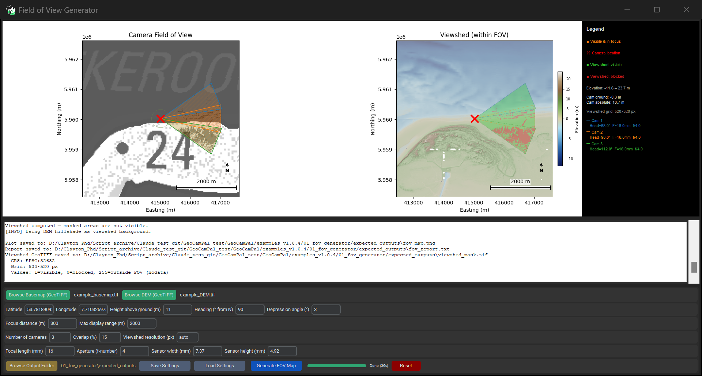
</p>

<p align="center">
  <em>Field-of-view visualisation with camera footprints and spatial context.</em>
</p>

---

### Lens Correction

The **Lens Correction** module computes camera intrinsic parameters from checkerboard calibration images using OpenCV. It supports rectangular checkerboards where the cell width and cell height may differ. At least three images with detected corners are required; the module reports the frame coverage of the detected corners.

The console and `calibration_report.txt` contain a **Result** block, and the closing message repeats its two headline statements:

- **Lens distortion:** how far the correction moves pixels, at the image centre, for half of all pixels, and at most, with the place of the largest movement. Each value has a **±**: the calibration is repeated once per photo without that photo, and the ± is the standard error over these runs (needs at least 4 photos).
- **Checkerboard fit:** GOOD, MARGINAL or POOR from the RMS reprojection error (below 0.5 px, below 1.0 px, 1.0 px or more). The fit describes how well the board was detected, not how strong the lens distortion is.

The report ends with an **Interpretation** section that says whether the photos show a lens distortion, what cannot be ruled out and what to improve. It is given only when the data allow it (for example at least 10 photos and 60 % corner coverage).

**Typical inputs**

- Folder of checkerboard calibration images
- Number of checkerboard squares across and down
- Cell width and height
- Distortion model (radial k1 + k2 recommended, up to the full five-term model)
- Output folder

**Typical outputs**

- `lens_calibration.pkl` (with a plain-text JSON sidecar)
- `calibration_report.txt`

<p align="center">
  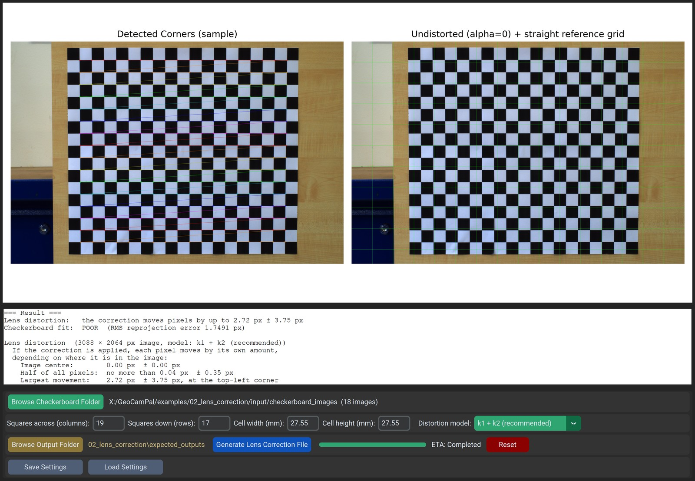
</p>

<p align="center">
  <em>Checkerboard-based intrinsic camera calibration with the Result block in the console and the undistortion preview.</em>
</p>

---

### Harmonise Images

The **Harmonise Images** module provides a multi-stage image quality and correction workflow. Original images are not overwritten.

#### Stage 1: Filter bad images

The filtering stage can flag images affected by:

- Blur
- Clipped over-exposure
- Under-exposure
- Darkness
- Low information content
- Rain or droplets on the lens
- Partial obstruction
- Failed, corrupt, truncated, or unreadable image files

**Filter inside AOI only** limits the seven image checks to an area of interest, for example to leave out a bright sky or the sun. **Select AOI** opens one of the images: drag a rectangle or click the corners of a polygon. Thresholds given as a fraction are then shares of the AOI. The AOI is scaled to images of another size and saved with the settings; harmonisation and averaging still use the whole image. With the option off, the filter gives the same results as before.

Every finished run writes **`filter_summary.txt`**: images checked, kept and rejected, the count and share per reason, the thresholds and AOI used, and the processing time. The same totals are stored in `bad_images.json`.

**Continuing an interrupted run:** progress is saved to `filter_progress.jsonl` in the output folder at least every 30 seconds and when the run is stopped with **Reset** or by closing the window. When the filter is started again with the same folders and settings, a dialog offers to continue after the last saved image. The progress file is removed when the run finishes.

#### Stage 2: Harmonise brightness

Brightness harmonisation supports luminance-based gain correction with soft-knee handling and L-channel histogram matching. Optional sky masking can be used when computing reference luminance.

#### Stage 3: Harmonise colour

Colour harmonisation supports:

- Reinhard colour transfer
- Per-channel LAB histogram matching
- Iterative distribution transfer

Both brightness and colour harmonisation have a **Preview**: it processes a random sample of the images, so the settings can be checked before the full run.

Averaging and lens correction list the images or folders they could not process, with the reason, in `averaging_skipped.txt` and `lens_correction_skipped.txt` next to the outputs. Brightness and colour harmonisation leave out images they cannot read; colour harmonisation names them in the console.

**Typical inputs**

- Image folder
- Output folder
- Selected filter thresholds
- Optional area of interest for the filter
- Optional reference image
- Optional lens calibration file
- Optional existing bad-image JSON file

**Typical outputs**

- `bad_images.txt`
- `bad_images.json`
- `filter_summary.txt`
- `<input_folder>_filtered_good/`, with **Export good filtered images** ticked
- `<input_folder>_brightness_harmonised/`
- `<input_folder>_colour_harmonised/`
- Additional workflow-specific folders such as averaged or lens-corrected outputs when those options are used

<p align="center">
  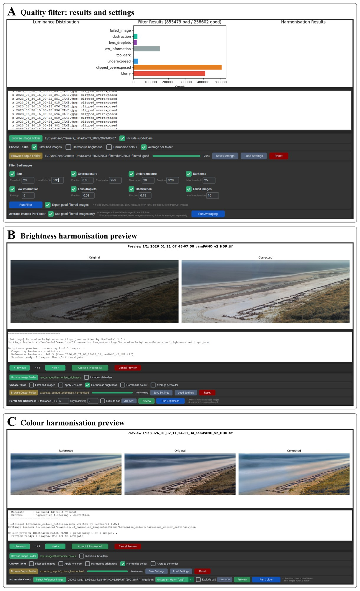
</p>

<p align="center">
  <em>(A) Quality-filter results with the thresholds in the configuration panel; (B) brightness harmonisation preview; (C) colour harmonisation preview.</em>
</p>

<p align="center">
  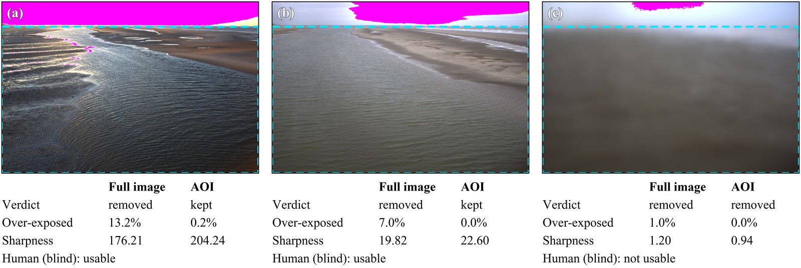
</p>

<p align="center">
  <em>Filter on the full image and inside an AOI that leaves out the sky (dashed), with the saturated pixels in magenta (example in <code>examples/03_harmonise_images/filter_sensitivity_test/</code>).</em>
</p>

---

## Data Exploration Tools

### Time Series Analysis

The **Time Series Analysis** module matches images to one or more hydrodynamic or environmental time series using timestamps extracted from image filenames. Up to five time series can be combined using AND logic.

Supported criteria include:

| Criterion | Description |
|---|---|
| **Peaks (Maxima)** | Select images within the search buffer of local maxima. |
| **Troughs (Minima)** | Select images within the search buffer of local minima. |
| **Above Threshold** | Select images where the time-series value is at or above a threshold. |
| **Below Threshold** | Select images where the time-series value is at or below a threshold. |
| **Near Target Value** | Select images near a user-defined value. |
| **Spring Tide Peaks** | Select images near spring high-water events. |
| **Neap Tide Peaks** | Select images near neap high-water events. |
| **No Filter** | Record values without filtering by that series. |

**Typical inputs**

- Image folder
- One to five time-series CSV files
- Timestamp parsing settings
- Per-series criteria
- Output folder
- Optional copy-selected-images setting

**Typical outputs**

- `matched_images_<mode_tag>.txt`
- Optional copied image folder, such as `images_<mode_tag>/`
- Spring/neap output folders when tidal classification workflows are used
- `skipped_images.txt`, listing images without a parseable timestamp in their file name

<p align="center">
  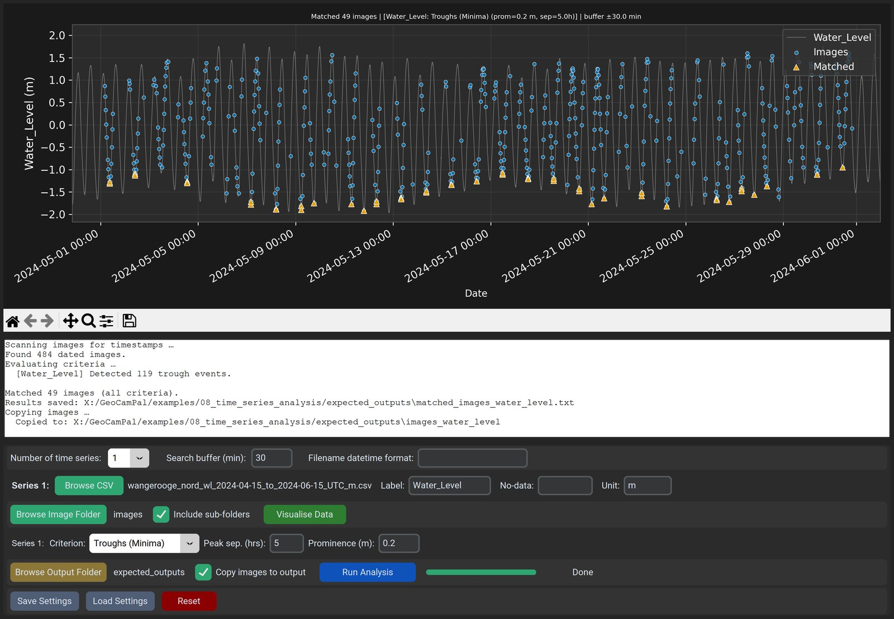
</p>

<p align="center">
  <em>Trough-based selection of images against a water-level record.</em>
</p>

---

### Colour Space Explorer

The **Colour Space Explorer** treats an image folder as a colour dataset. It can visualise channel distributions, two-dimensional scatter-density plots, colour timelines, and colour-profile outliers.

Supported colour spaces:

- RGB
- HSV
- LAB
- Normalised RGB

One **Run Analysis** produces all of these:

| Analysis | Description |
|---|---|
| **Channel histograms** | Per-channel colour distributions. |
| **2-D scatter density** | Joint distribution between selected colour channels. |
| **Colour timeline** | Channel statistics through image time. |
| **Outlier detection** | Flag images with anomalous colour statistics. |

**Typical inputs**

- Image folder
- Output folder
- Colour space
- Channel selections
- Optional AOI polygon
- Optional feature class
- Outlier threshold

**Typical outputs**

- `color_stats.csv`
- `outliers.txt`, when outliers are detected
- `color_explorer_plots.png`
- Additional plots exportable from the Matplotlib toolbar

<p align="center">
  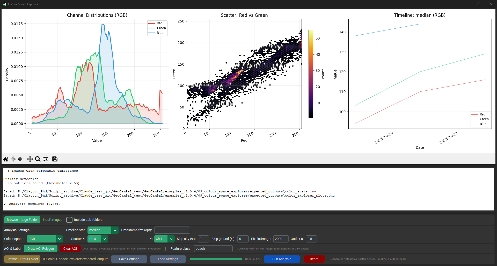
</p>

<p align="center">
  <em>Colour distribution, scatter-density, and temporal colour analysis.</em>
</p>

---

## Georeferencing Tools

### Pixel to GCP

The **Pixel to GCP** module lets users select the image pixel that corresponds to each surveyed ground-control point. GCP photographs are paired with their points by a GCP identifier such as `GCP_12` in the file name and in the `GCP_ID` column, and the module supports flexible GCP CSV column names.

The GCP file may contain either:

- **Latitude and longitude**, optionally converted to UTM with the EPSG code detected automatically; or
- **Projected Easting and Northing** (or x and y), written unchanged, with the EPSG code taken from an `EPSG` column or the field **EPSG for Easting/Northing** (enter 0 for a local coordinate system). Files without a valid projected code are refused with a message that says what to change.

The pixel under the cursor is stored at every zoom level; pixel coordinates count from 0 at the top-left pixel, and whole numbers are pixel centres.

**Typical inputs**

- Folder containing GCP images
- GCP coordinate CSV file (geographic or projected)
- Optional bad-GCP exclusion list
- Output folder
- Output CSV filename

**Typical outputs**

A CSV containing pixel-to-world mappings, including fields such as:

- `Image_name`
- `Pixel_X`
- `Pixel_Y`
- `GCP_ID`
- `camera`
- `Real_X`
- `Real_Y`
- `Real_Z`
- `EPSG`

<p align="center">
  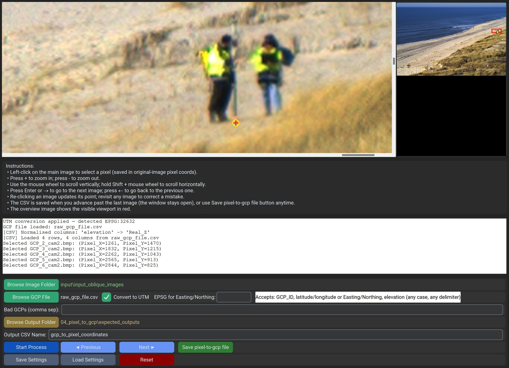
</p>

<p align="center">
  <em>Interactive selection of image pixel coordinates for ground-control points.</em>
</p>

---

### Homography Generator

The **Homography Generator** computes 3 × 3 homography matrices from pixel-to-world GCP mappings.

It supports:

- RANSAC-based homography estimation on normalised point sets
- **Compute Accuracy**: for each GCP, the distance for the matrix fitted on all GCPs and the **leave-one-out** distance (the matrix fitted again without that GCP), with mean, median, RMS and maximum for both. Leave-one-out needs at least 5 GCPs.
- Manual GCP exclusion
- Advanced simulated-annealing search for GCP subset selection

**Typical inputs**

- GCP CSV file containing at least `GCP_ID`, `Pixel_X`, `Pixel_Y`, `Real_X`, and `Real_Y`
- Optional list of GCPs to exclude
- Output folder
- Output filename

**Typical outputs**

- `<output_name>.txt`
- `<output_name>_accuracy.csv`, the per-GCP accuracy table
- `<output_name>_bestsubset.txt`, when using the advanced subset-optimisation workflow

<p align="center">
  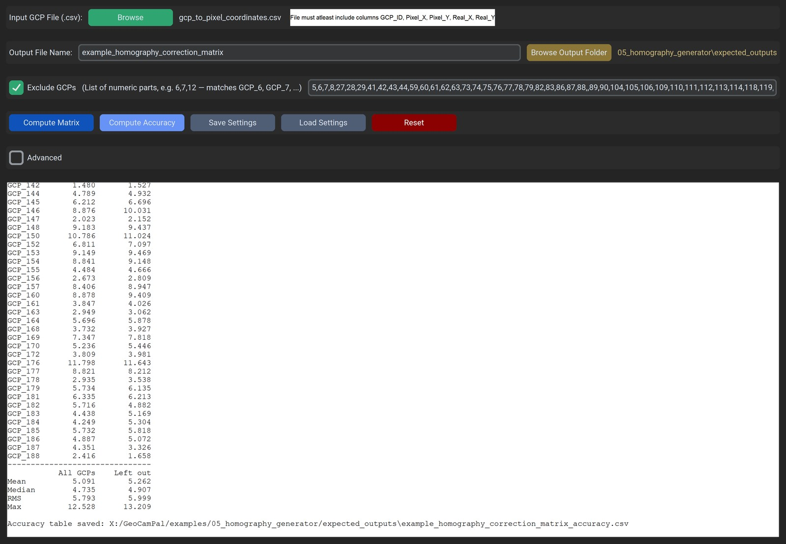
</p>

<p align="center">
  <em>Homography matrix creation with the fitted and leave-one-out distance of each GCP.</em>
</p>

---

### Georef Images

The **Georef Images** module rectifies oblique images into a spatial reference system. It supports several georeferencing methods, not only homography.

Supported methods include:

- Homography
- Camera Projection
- Thin Plate Spline
- Polynomial Ord-1 (first order)
- Polynomial Ord-2 (second order)

The required inputs depend on the selected method. Homography uses a precomputed matrix, while camera projection and GCP-based methods require appropriate GCP and calibration information. For the GCP-based methods (Camera Projection, Thin Plate Spline, Polynomial), **Compute Accuracy** reports leave-one-out residuals, and **Optimise GCPs (SA)** looks for the two GCPs (one, when only five are in use) whose exclusion gives the lowest mean leave-one-out residual of the others (100,000 simulated-annealing steps, with a progress bar and the remaining time; the button turns into **Stop optimisation**) and adds them to **Exclude GCPs**. For a homography, these diagnostics are in the Homography Generator. All methods work in a projected coordinate reference system identified by an EPSG code; the code is read from the GCP CSV or the homography file when present.

The three preview panels show the original, the initial and the secondary georeferencing; each can be zoomed (mouse wheel) and moved. **Process All** writes what the secondary preview shows.

Batch runs validate every written GeoTIFF and write files that fail the check again, up to 10 times. Tick **Skip existing** to resume an interrupted batch: images whose outputs are already present and valid are skipped. Files that still fail, or whose writing ended with an error, are listed in `georef_failures.txt`. An input image that cannot be read is skipped with an `[imread]` line in the console and is not in that list.

**Typical inputs**

- Input image or image folder
- Selected georeferencing method
- Homography matrix or GCP CSV, depending on method
- Lens calibration file (`.pkl`), required for Camera Projection
- EPSG/spatial reference information
- Corner preset and crop values
- Optional AOI selection
- Output folder
- Batch-processing settings

**Typical outputs**

- Georeferenced `.tif` files
- Batch outputs for single folders or subfolders
- `georef_failures.txt`, written only when a batch has failures
- Preview outputs inside the GUI before final processing

<p align="center">
  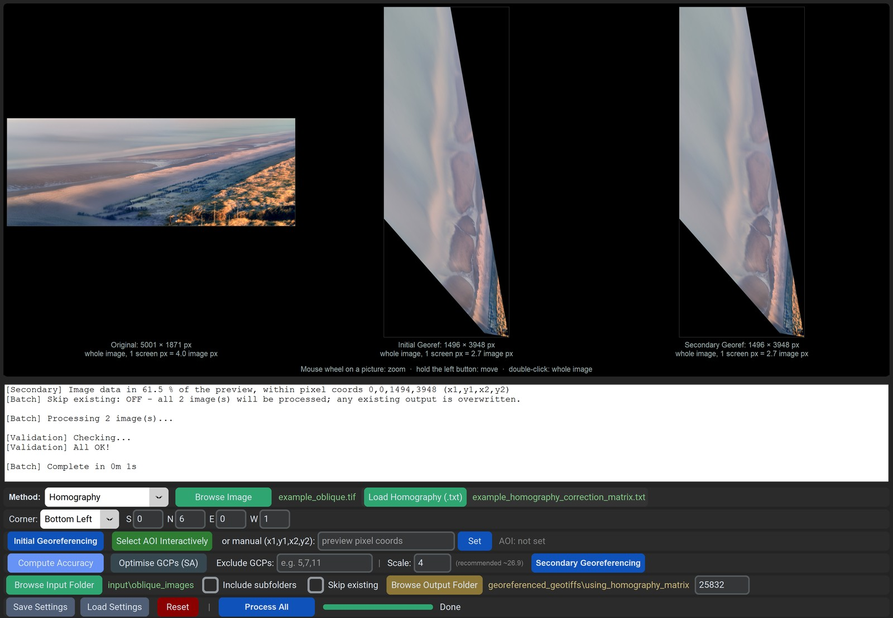
</p>

<p align="center">
  <em>Georeferencing workflow with the original image and the initial and secondary georeferenced previews.</em>
</p>

---

## Feature Identification and Labelling Tools

The **Feature Identification and Labelling Tools** combine automatic HSV colour masking with area-of-interest filtering, colour-picker classification, and manual feature editing. They are designed for extracting visible features such as shorelines, waterlines, swash fronts, masks, polygons, and polylines from imagery, and for building machine-learning training data.

The tools are organised into three modes:

| Mode | Purpose |
|---|---|
| **Single Image** | Tune detection settings and export features from one image. |
| **Folder Processing** | Step through an image folder, refine features, and export training-style outputs. |
| **Batch Processing** | Apply saved or predefined detection settings across a folder. |

Feature identification tools include:

- HSV colour masking
- Optional dual-HSV masking
- Area of interest (AOI) and profile line, which limit where the colour detection looks
- ML-predicted mask support
- Multi-sample colour picker
- Boundary extraction
- Polygon extraction
- Freehand, vertex, polyline, and polygon editing
- Undo/redo during editing
- Georeferenced export where spatial information is available

**Shape editor and labels.** Each shape can carry its own label and category ID; a label keeps its category ID across shapes and images, and the label catalogue is saved with the settings, so **Load Settings** carries it into a later session. Shapes are selected by clicking or with **Prev shape** / **Next shape**; **Delete Shape**, **Delete All**, **Cancel** (Esc) and undo/redo cover every action. A double-click ends a line, and a click near the first vertex closes a polygon.

Detected vertices are placed at the centres of the mask pixels, in full-image coordinates, and all three modes work on the same working copy (at most 1200 px), so a batch run gives what the same settings showed on a single image.

GeoJSON exports carry the coordinate reference system of the source GeoTIFF; for inputs without one, the GeoJSON contains pixel coordinates. Batch processing lists any image it could not read in `batch_skipped.txt`.

**Typical inputs**

- Image or image folder
- Optional associated mask file or mask folder
- HSV settings
- AOI/profile settings
- Colour-picker samples
- Labels and category IDs
- Optional georeferencing information
- Export/output folder

**Typical outputs**

The export buttons for training and test data write into a `Dataset/` folder inside the export folder, with `training dataset/`, `test dataset/` and, for images with two or more labels, `training_dataset_multiclass/`. They may include:

- `images/`
- `masks/`
- `overlays/`
- `geojson/`
- `coco/`
- Multi-class sets: a label-map PNG (pixel value = category ID), GeoJSON with label attributes, COCO with all categories, and `categories.json`
- Optional class-point CSV outputs

An image with one label gives the same set of files, with the same names, as before. An export is refused, before any file is written, when two labels share a category ID.

**Export as Overlay** writes `<image>_overlay.png` into the export folder itself. Batch Processing also writes straight into the export folder, without the `Dataset/` level:

- `geojson/`
- `shoreline overlay/`
- `images/`, `masks/` and `coco/`

<p align="center">
  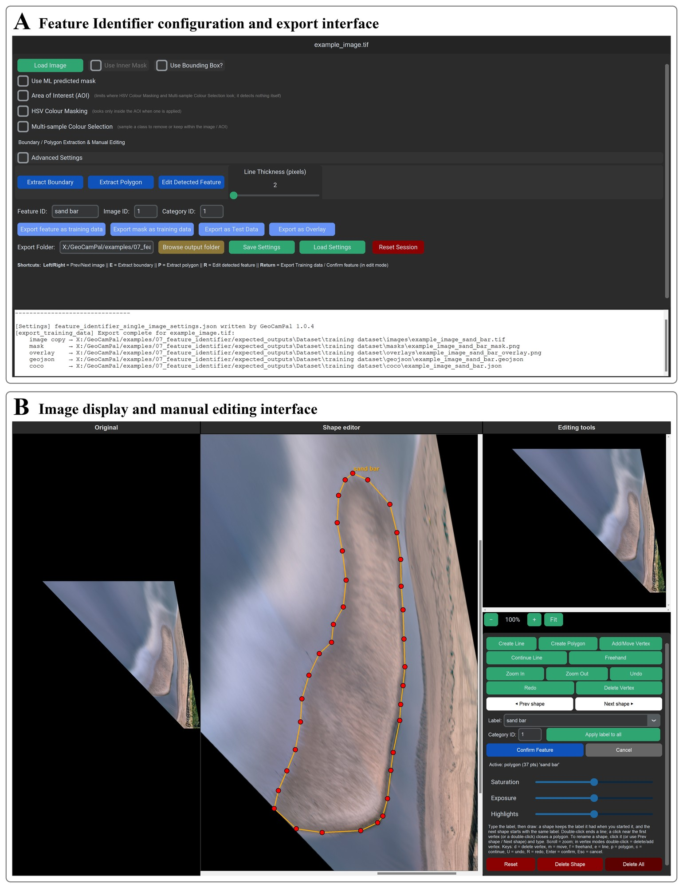
</p>

<p align="center">
  <em>(A) Configuration panel with the detection settings and the export console; (B) shape editor with the detected sandbar and the editing toolbar.</em>
</p>

---

## DEM Generator Tools

### Create DEM

The **Create DEM** module creates digital elevation models from shoreline GeoJSON files and water-level data.

The module uses PCA-aligned cross-shore transect interpolation to reduce artefacts that can occur with direct triangulation at contour edges. It supports both daily and composite DEM workflows. Each height is written to the GeoTIFF cell centred on its position. The DEM inherits the coordinate reference system of the shoreline files and the vertical datum of the water-level record; no datum transformations are applied, so all inputs must share one projected CRS and one vertical datum.

**Typical inputs**

- Water-level CSV file
- Shoreline GeoJSON folder
- Filename pattern for parsing shoreline dates/times
- DEM resolution
- Vertex spacing
- Smoothing parameter
- Beach-shape setting
- DEM mode: daily or composite
- Output folder
- Optional XYZ export

**Typical outputs**

For daily DEM mode:

- `DEM_<date>_transect.tif`
- `shoreline_xyz_<date>.csv`, when XYZ export is enabled

For composite DEM mode:

- `DEM_composite_<tag>_transect.tif`
- `shoreline_xyz_composite_<tag>.csv`, when XYZ export is enabled

<p align="center">
  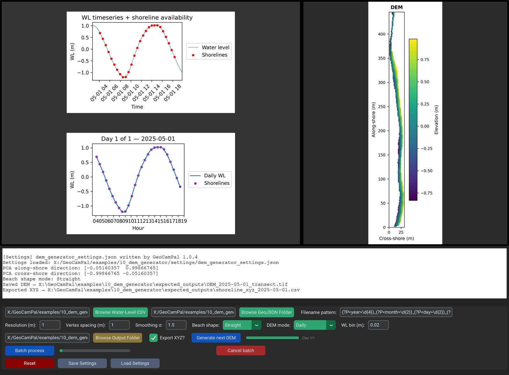
</p>

<p align="center">
  <em>DEM generation from shoreline features and water-level data.</em>
</p>

---

## Timestacking Tools

### Profile & Hovmöller

The **Profile & Hovmöller** module extracts pixel profiles along a user-defined line across a folder of images. Users can draw a profile line interactively or enter pixel coordinates manually.

The module can generate either an RGB Hovmöller diagram or an intensity Hovmöller diagram depending on the selected mode.

**Typical inputs**

- Image folder
- Optional recursive search
- Filename datetime format
- Sample image
- Profile start and end coordinates, or an interactively drawn line
- Profile width
- Selected Hovmöller mode
- Output folder

**Typical outputs**

- `hovmuller_rgb.png` or `hovmuller_intensity.png`, depending on selected mode
- `profile_overlay.png`
- `profiles.txt`
- `skipped_images.txt`, listing images without a parseable timestamp in their file name

<p align="center">
  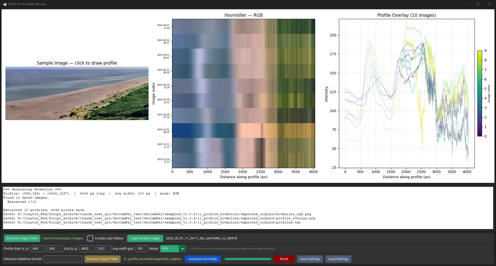
</p>

<p align="center">
  <em>Pixel profiles along a line through an image folder, shown as a Hovmöller diagram.</em>
</p>

---

### Burst Images Timestacker

The **Burst Images Timestacker** creates calibrated timestack images from image sequences. It supports timestamp parsing from filenames, EXIF/TIFF metadata, and file modification time as a fallback.

Selection modes include:

- Bounding-box selector
- Straight-line selector
- Freehand-line selector

Batch mode processes every burst folder under a root folder; with **Include sub-folders** on, folders at any depth are found and the input folder structure is mirrored in the output.

**Typical inputs**

- Image folder or batch subfolders
- ROI, line, or freehand selector
- Pixel resolution
- Capture frequency and burst duration
- Optional gap-filling settings
- Output folder

**Typical outputs**

- `<first_timestamp>_raw_timestack.png`

The output PNG stores timestack metadata: selector information, the pixel resolution (`pixel_resolution`), the time interval per row (`time_interval`) and the stack duration (`duration_s`). The Wave Run-up module reads the pixel resolution and the time interval automatically.

<p align="center">
  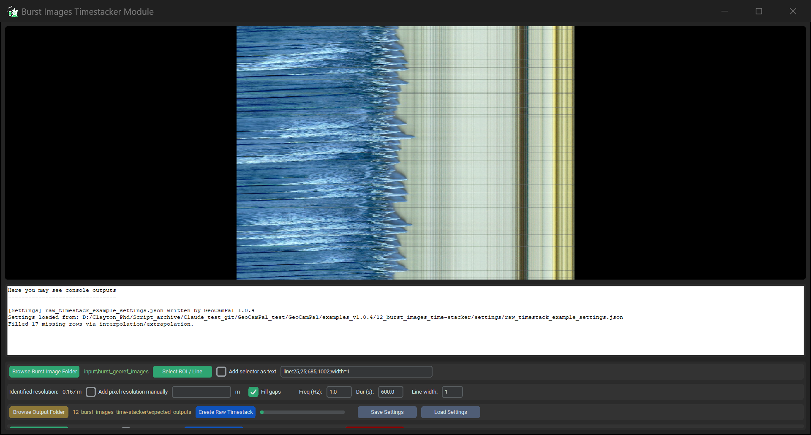
</p>

<p align="center">
  <em>Generation of calibrated timestack imagery from image sequences.</em>
</p>

---

### Wave Run-up

The **Wave Run-up** module extracts the run-up edge from annotated timestack imagery and exports time-distance data. It supports multiple annotation formats, all of which the Feature Identification and Labelling Tools can export.

Supported annotation inputs:

- PNG binary mask
- GeoJSON annotation
- COCO-style JSON annotation

The module uses the pixel resolution and time interval embedded in timestack PNGs when available; a timestack without an embedded pixel resolution is read at 0.25 m per pixel. A **Time per row** readout states which value is in use and where it came from; a **Manual time interval** option overrides it, which is needed for timestacks made with versions before v1.0.2, which carry no time interval and are otherwise read as 1 s per row. Distance is measured along the transect from its seaward end; set **Land on left** when the land is on the left of the timestack. Batch mode pairs each timestack in one folder with its annotation in another and lists unpaired or failed files in `wave_runup_skipped.txt`.

For the optional Stockdon comparison, tick **Compare to Stockdon Run-up** and enter the foreshore slope, the deep-water wave height H₀ and the peak period T₀. The comparison then reports the observed R₂%, the 98th percentile of the run-up series with its mean removed, and the **observed significant swash height** S, 4 × the standard deviation of that series (as defined by Stockdon et al., 2006), in the console, the run-up CSV and the comparison file. With a **Beach Slope** (the slope along the transect) the series, R₂% and S are vertical, otherwise horizontal; the outputs say which. A difference from the Stockdon R₂% is written only for a vertical R₂%.

**Typical inputs**

- Raw timestack PNG
- Run-up annotation file
- Pixel resolution or embedded metadata
- Time interval or embedded metadata
- Land on left setting
- Optional beach slope along the transect
- Optional Stockdon parameters
- Output folder

**Typical outputs**

- Run-up time-distance CSV; with the Stockdon comparison, comment rows give the observed R₂%, the swash height S and whether they are vertical or horizontal
- PSD CSV
- Clean run-up plot PNG
- Optional Stockdon comparison text output
- Batch-mode per-file outputs and optional Stockdon summary

<p align="center">
  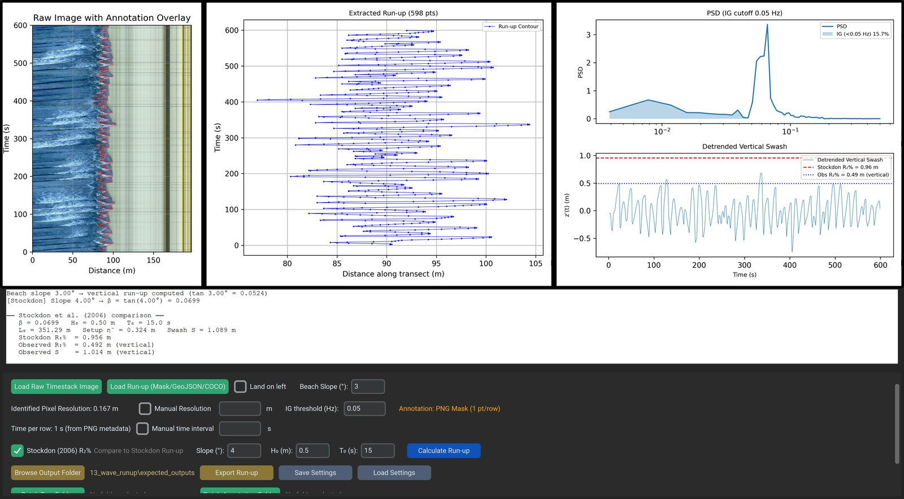
</p>

<p align="center">
  <em>Wave run-up extraction and spectral analysis from timestack imagery.</em>
</p>

---

## Typical Outputs

Depending on the selected module, GeoCamPal can generate:

| Output Type | Examples |
|---|---|
| **Processed images** | Filtered, brightness-harmonised, colour-harmonised, averaged, or lens-corrected image folders |
| **Geospatial rasters** | GeoTIFF DEMs, georeferenced image outputs, optional viewshed rasters |
| **Vector data** | GeoJSON feature exports, with label attributes for multi-class data |
| **Training data** | Images, masks, overlays, COCO files, multi-class label maps and `categories.json` |
| **Tables** | CSV, TXT, XYZ, matched-image tables, profile tables, run-up tables, homography accuracy tables |
| **Calibration files** | Lens calibration `.pkl` files with JSON sidecar |
| **Reports** | Bad-image logs, filter summaries, skipped-file reports, calibration reports, FOV reports, processing summaries |
| **Plots** | FOV maps, colour-space plots, Hovmöller plots, run-up plots, PSD plots |

---

## Dependencies

Core dependencies (see `requirements.txt` for minimum versions):

```text
customtkinter
Pillow
opencv-python
numpy
pandas
rasterio
geopandas
shapely
GDAL
utm
matplotlib
tifffile
scipy
pyproj
scikit-image
```

The v1.0.4 Windows executable bundles Python 3.12.9, CustomTkinter 5.2.2, Pillow 11.2.1, OpenCV 4.11.0, NumPy 2.2.4, pandas 2.2.3, SciPy 1.15.2, Matplotlib 3.10.1, GDAL 3.10.3, Rasterio 1.4.3, GeoPandas 1.0.1, Shapely 2.1.0, PyProj 3.7.1, scikit-image 0.25.2, tifffile 2025.3.30 and utm 0.8.1.

> **Note:** GDAL can require special installation steps on some platforms. Using `conda install -c conda-forge gdal` or pre-built wheels is often the easiest approach if `pip install GDAL` fails. Install `scikit-image` with the other requirements; without it, histogram-based brightness and colour harmonisation, mask skeletonisation and the automatic threshold suggestion in the profile preview of the Feature Identifier fall back to simpler methods without a message.

---

## Citation

If you use GeoCamPal, please cite the archived release:

> Soares, C. C., Noronha, A., & Winter, C. (2026). GeoCamPal (Version v1.0.4) [Computer software]. Zenodo. https://doi.org/10.5281/zenodo.23082278

The DOI [10.5281/zenodo.23082278](https://doi.org/10.5281/zenodo.23082278) represents all versions and always resolves to the latest release; the DOI of each version is listed on that Zenodo page. Citation metadata is also provided in [`CITATION.cff`](CITATION.cff).

---

## Contributing

Contributions, bug reports, and feature requests are welcome.

To contribute:

1. Open an issue describing the bug, feature request, or proposed improvement.
2. Fork the repository.
3. Create a new branch.
4. Submit a pull request with a clear description of your changes.

Good first issues are listed here:

[Good first issues](https://github.com/capt-clay10/GeoCamPal/labels/good%20first%20issue)

---

## License

GeoCamPal is distributed under the **MIT License**.

See the [LICENSE](LICENSE) file for details.

---

## Disclaimer

This software is provided *as is*. Users should validate all outputs before using them in scientific, engineering, operational, or decision-critical analyses.

---

## Creator and Contact

**Creator:** Clayton Soares
**Contact:** clayton.soares@ifg.uni-kiel.de
**Institute:** Institute of Geosciences, CAU Kiel
**Source:** [github.com/capt-clay10/GeoCamPal](https://github.com/capt-clay10/GeoCamPal)
